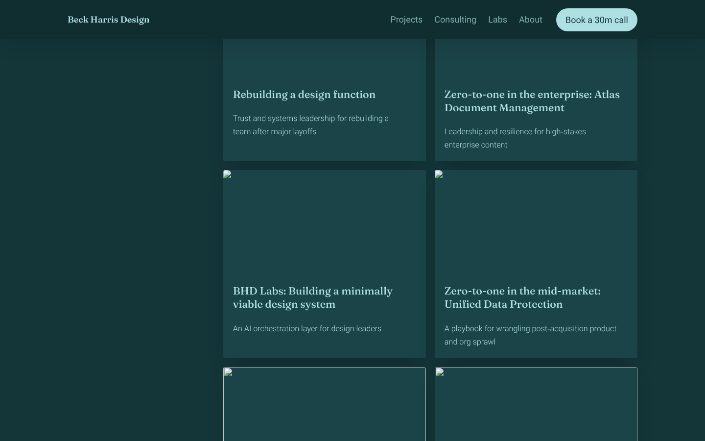
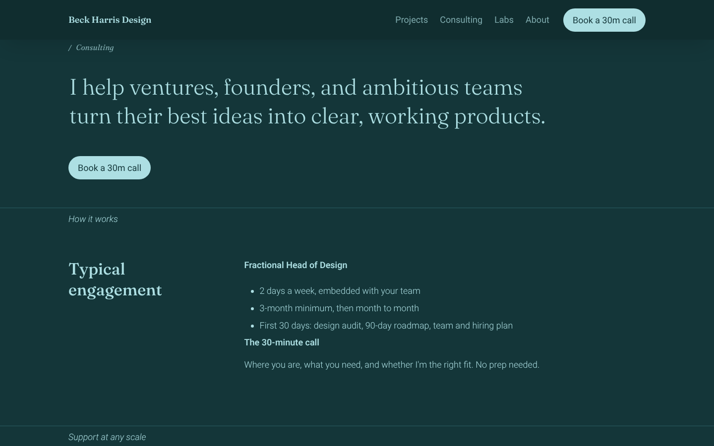
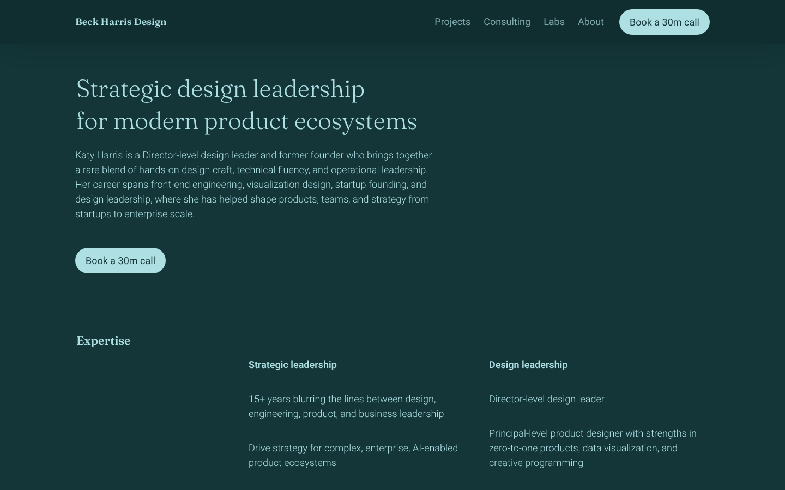
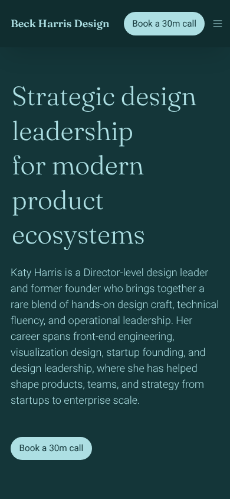
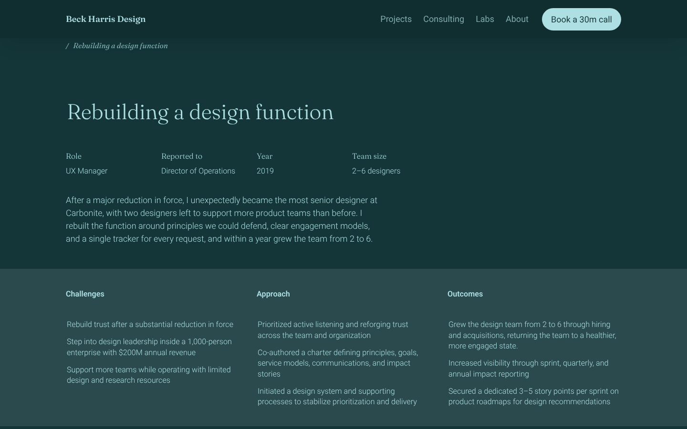
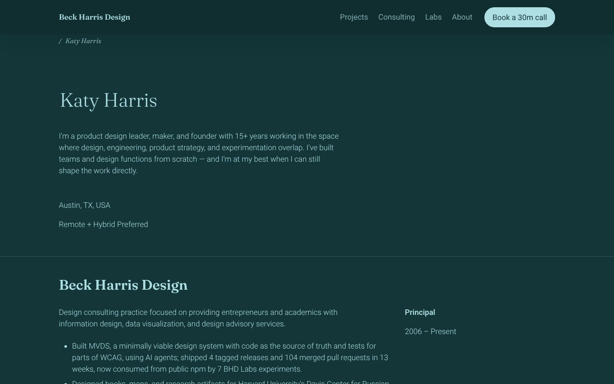

# Portfolio feedback — November 2026

A colleague's annotated review of **beckharrisdesign.com** (4 pages, marked-up
screenshots). This file logs every note verbatim, says where each one lives
today, and groups them into the OpenSpec changes that will deal with them.

- **Source:** annotated PDF from the colleague, 2026-11-13 (8MB, not committed;
  every note is transcribed below word for word)
- **As-is captures:** [`as-is/`](as-is/), taken from the live site 2026-11-13 at
  1440×900 and 390×844, plus [`as-is/measurements.json`](as-is/measurements.json)
- **Where things live:** content is in **Notion** (Super renders it). Styling is
  in **`public/super/site.css`**, behaviour in **`public/super/*.js`** (see the
  [experiment README](../../README.md))

---

## 1. Every note, verbatim

`Lives in` says what has to change: **CSS** (site.css), **JS** (a script
under `public/super/`), **Notion** (content or block structure), **Asset**
(an image or illustration someone has to make).

### Homepage

| ID | Spot | Note | Lives in | Change |
|---|---|---|---|---|
| HD-1 | Navbar | "Reduce the header height on scroll. The height of it is fine on load, but feels like it takes up too much space on scroll" | CSS + JS | `portfolio-header-hero` |
| PL-1 | Whole page | "LOVE LOVE LOVE this green primary palette. Try adding a secondary palette of warm accents. They could serve as fun pops of color." | CSS | `portfolio-warm-accents` |
| HR-1 | Hero | "Make the hero on the homepage more immersive than what's on the subpages. This should be your front door. Less text, bigger type?" | CSS + Notion | `portfolio-header-hero` |
| HR-2 | Hero | "Try adding a visual element that expresses something about you, e.g. pattern, photo, doodle, anything really. It can be personally meaningful without revealing too much personal detail" | Asset + CSS | `portfolio-header-hero` |
| EX-1 | Expertise | "Good content. Maybe it could be expressed like a Tufte-esque infographic?" | Notion + CSS/JS | `portfolio-data-moments` |
| GR-1 | Case studies grid | "Try more fluid grid layouts, like masonry style or more editorial style blocks." | CSS | `portfolio-case-grid` |
| GR-2 | Case studies grid | "Keep titles and descriptions around the same word count so that they rag evenly in the grid." | Notion | `portfolio-case-grid` |
| PL-2 | Speaking + teaching | "This would be a nice spot for small pops of color, e.g. keywords, icons (if you decide to add any), the background fills for years." | CSS | `portfolio-warm-accents` |
| CT-1 | Let's connect | "contact promo could be styled with more pop so it stands out from the other sections" | CSS | `portfolio-contact-promo` |
| LG-1 | Lagniappe | "Might make a nice interactive animated marquee strip" | JS component | `portfolio-lagniappe-marquee` |

### Case study — Rebuilding a design function

| ID | Spot | Note | Lives in | Change |
|---|---|---|---|---|
| HD-2 | Breadcrumb | "Is the breadcrumb needed here?" | CSS | `portfolio-header-hero` |
| HR-3 | Hero, right side | "Try a visual element that expresses something about the project" | Notion (cover) + CSS | `portfolio-header-hero` |
| CS-1 | Challenges / Approach / Outcomes band | "Subtle visual elements could work here, e.g. typographic ornaments. If you're into icons, that could work here too, but iconography doesn't seem to be a part of your visual language." | CSS | `portfolio-case-study-storytelling` |
| CS-2 | Body sections | "Content is good but could be displayed more dynamically. Maybe instead of reposting the slides as is, they can be photoshopped in a way that highlights key points or quotes. Show, don't tell" | Asset + Notion | `portfolio-case-study-storytelling` |
| NX-1 | Related projects | "The footer navigation can be more typographically expressive. They made it this far. Get people excited to click to the next one." | CSS + Notion | `portfolio-next-project` |

### About (Katy Harris)

| ID | Spot | Note | Lives in | Change |
|---|---|---|---|---|
| AB-1 | Intro | "This section of your site should express the scientific curiosity side of your personality, there are some personal details that you could express visually" | Asset + Notion | `portfolio-about-narrative` |
| AB-2 | Résumé | "The résumé section might have too much text. Nobody reads anymore. Maybe there's a download link to read the resume. Here's an idea: Instead of listing each experience out, tell us about highlights in one nicely typeset block with hyperlinks to other content on your site. One big paragraph with a strong narrative voice that provides pathways throughout your site." | Notion + CSS | `portfolio-about-narrative` |
| NX-1 | Footer | (same footer-navigation note as the case study) | | `portfolio-next-project` |

### Consulting

| ID | Spot | Note | Lives in | Change |
|---|---|---|---|---|
| HD-3 | Breadcrumb | "Breadcrumb is redundant if menu link is highlighted" | CSS | `portfolio-header-hero` |
| HR-4 | Hero | "Hero bg in different color than the page?" | CSS | `portfolio-header-hero` |
| RY-1 | "How it works" eyebrow | "Padding feels tight between divider and eyebrow" | CSS | `portfolio-data-moments` |
| PL-3 | Services list | "Might be nice to add some accent color(s)" | CSS | `portfolio-warm-accents` |
| ST-1 | Stats ("20+ / 2 / 1 / ∞") | "Love these stats. Try making them HUUUGE (within reason)" | CSS | `portfolio-data-moments` |
| GR-3 | Card grid | "Card grid might need to be teed up with a header and brief description. Abrupt transition from the call outs to the grid. Not quite sure they're projects until button is in view" | Notion | `portfolio-case-grid` |
| CT-2 | Let's connect | "This could pop" | CSS | `portfolio-contact-promo` |
| NX-1 | Footer | (same footer-navigation note) | | `portfolio-next-project` |

**What the colleague liked, so we keep it:** the green palette ("LOVE LOVE
LOVE"), the expertise content, the case-study content, the consulting stats.
Nothing here asks to change the voice. It asks for more confidence in how it
is shown.

---

## 2. The changes, in order

One OpenSpec proposal each. Order is by dependency, then by how much a first
visit is affected.

| # | Change | Notes it covers | Depends on | Size |
|---|---|---|---|---|
| 1 | **`portfolio-header-hero`** ← *today* | HD-1, HD-2, HD-3, HR-1, HR-2, HR-3, HR-4 | — (HR-2 can start on a placeholder) | M |
| 2 | `portfolio-warm-accents` | PL-1, PL-2, PL-3 | — | S — tokens, then applied in 3 spots |
| 3 | `portfolio-contact-promo` | CT-1, CT-2 | 2 | S |
| 4 | `portfolio-case-grid` | GR-1, GR-2, GR-3 | — | M — masonry vs. editorial is a real decision |
| 5 | `portfolio-data-moments` | EX-1, ST-1, RY-1 | 2 (for colour in the infographic) | M |
| 6 | `portfolio-next-project` | NX-1 | — | S |
| 7 | `portfolio-case-study-storytelling` | CS-1, CS-2 | 2 | L — mostly asset work, one case study first |
| 8 | `portfolio-about-narrative` | AB-1, AB-2 | 6 (pathways out) | M — mostly writing |
| 9 | `portfolio-lagniappe-marquee` | LG-1 | — | S — a new `::marquee` component |

**Why the palette is second, not first.** Four other changes reach for
"accent colour", so the tokens should exist before they do. But the header
and hero affect every visit and can be built on today's palette, with one
slot left open for a warm accent.

---

## 3. As-is: header and hero

From the live site, 2026-11-13. Numbers are from
[`as-is/measurements.json`](as-is/measurements.json).

### Navbar (HD-1)

- **80px, sticky, the same height at every scroll position.** Super's
  `--navbar-height: 80px`. At 1440×900 that is **9% of the viewport**, all
  the time.
- Super adds **no class or attribute on scroll** (`super-navbar simple`
  before and after), so a compact state needs our own trigger: CSS
  scroll-driven animation or a few lines of JS.
- Styled in `site.css` §3 (alignment to the page grid, logo size, CTA).

### Breadcrumb and active state (HD-2, HD-3)

- A **32px breadcrumb bar** sits under the navbar on every subpage. The
  "Home" crumb is already hidden (§3), so it shows one item, the page title.
- **The nav has no active state.** Every `.super-navbar__item` has the same
  colour and weight, no `aria-current`, no active class. That is why the
  breadcrumb is doing the "you are here" job.
- An active state can be pure CSS: the page's class (`.page__bhd-consultation`,
  `.parent-page__index`, …) is in the DOM, so `:has()` can select the right
  link. No JS needed.
- "Projects" links to `/`, so case studies (children of the homepage) would
  highlight Projects.

### Homepage hero (HR-1, HR-2)

- A Notion **column list, 447px tall**: H1 (Fraunces 300, 45px, two lines),
  a **70-word paragraph** in five lines, a CTA.
- The **right half of the hero is empty** at desktop width.
- The hero is built the same way as every subpage hero, with the same type
  size (`h1.notion-heading { font-size: 2.5rem }` in §4). Nothing marks it
  as the front door.
- **Phone (390×844):** the H1 wraps to five lines and the paragraph to nine.
  The CTA lands at about 760px, just inside the first screen.

### Subpage heroes (HR-3, HR-4)

- **Case study:** no cover image, so Super draws an empty cover box (held to
  3rem in §4). Title, a 4-up properties row and the summary sit on the left.
  The right ~40% is empty, which is where the note puts a project visual.
- **Consulting:** the hero is a plain H1 and a button on the page colour,
  with a divider underneath. No band, so it reads as the first section rather
  than a hero.
- **About:** same pattern as the case study (cover box, title, intro). AB-1
  covers its personal visual; this change gives it the same hero frame only.

---

## 4. Capture method

Playwright against the live site, no login. Screens at 1440×900 and 390×844,
deviceScaleFactor 1, one shot at load and one after scrolling 1200px. The
measurements are `getBoundingClientRect` and computed styles for
`.super-navbar`, `.super-navbar__breadcrumbs`, `.notion-header` and the first
in-page CTA, plus Super's navbar theme variables. The script is short enough
to rebuild from that description. It is not committed, because the
selectors it reads already belong to `scripts/super-css/check.mjs`.
