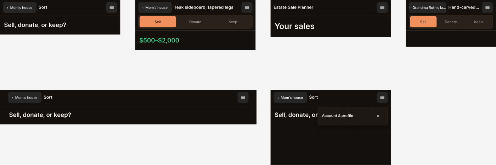

# Design: esp-header-affordance

## Context

The planner's sticky header is `app/estate-sale-planner/TopBar.tsx`, rendered by `AppShell` on
every page under `/estate-sale-planner`. Today it is a one-line breadcrumb (sold-comps D11):

- `chromeFor` (`lib/estate-sale-planner/routes.ts`) returns `{ title, crumbs, back? }` for each
  route. `crumbs` runs Home → sale → (item, on the source photo); `back` is already the last
  crumb's href.
- `TopBar` renders every crumb as muted 14 px link text with `/` separators, and collapses the
  leading crumbs to `…` under 640 px. #564 gave the links a 45 px tap height (`py-3`), but nothing
  marks them as controls.
- The row is MVDS `Chrome` (top), which clips to `--chrome-top-height`: 2.75 rem alone, 6.75 rem
  with the item screen's destination toggle (D21).
- On touch, `.esp-theme` floors every MVDS `Button` at 44 × 44 px (`app/globals.css`, #564).
- MVDS 0.5.0 has `Button` and `Chrome`, but no Dialog, Sheet or Popover.

The spec is `specs/esp-app-header/spec.md`. Option A was picked (Katy, 2026-10-28: "A for now").

## Goals / Non-Goals

**Goals:**

- One obvious way back: a Back button with a chevron and the parent's name, on every screen
  below Home.
- The current screen's name always visible; long names truncate, the controls never shrink.
- A Menu button at the right edge of every planner page, opening an empty "Account & profile" panel.
- No new routing or data: everything the header needs already comes from `chromeFor`.

**Non-Goals:**

- Real menu items, accounts, personas or sign-in.
- Changing the tab bar, the routes, or which pages get the header.
- A separate desktop header (desktop gets the same row, with more room).
- Promoting a Dialog primitive into MVDS (it's noted as a hand-off candidate below).

## User flow / IA

```
[‹ Parent]  Title ……………………………… [☰]
```

- **Back:** goes to `chrome.back`, labelled with the last crumb's label:
  - Sort, Progress, Add photos, item → `‹ <sale name>` → that sale's Items screen
  - a sale's Items screen, Take photos, the Sell Sheet → `‹ Home` → Home
  - Source photo → `‹ <item name>` → that item
  - Sell list → `‹ <sale name>` when a sale is in context, else `‹ Home`
  - Home → no Back button; the title ("Estate Sale Planner") starts the row
- **Title:** `chrome.title`, `aria-current="page"`, single line, ellipsis.
- **Menu:** opens a modal panel anchored under the button at the top right:
  - heading "Account & profile"
  - a Close (✕) button
  - nothing else: no body copy (Katy cut the explanatory sentence in round 02.1)
  - closes on ✕, Escape or a tap on the backdrop, with focus returned to Menu
- **Item screen:** the destination toggle stays as the second row of the sticky header.
- **Crumbs above the parent** are no longer shown. Getting to Home is one more Back, or the Home tab.

## Visual design / Figma

> UI changes require a Figma **as-is + proposed** pair (see `openspec/changes/stop-the-leaks/design.md`). N/A only for genuinely no-UI changes.

| Item               | Value |
| ------------------ | ----- |
| Primary file URL   | <https://www.figma.com/design/TsnWXZIK9TgMlxX7kPy9BQ> (`esp-header-affordance`) |
| As-is frame(s)     | Page `01 Current state` (`0:1`): `Current · Mobile 428` (`2:2`, round 01), `Current · Sort · Mobile 480` (`8:2`), `Current · Sort · Desktop 1024` (`8:12`). Rebuilt from `TopBar.tsx`; colours are `.esp-theme` values. |
| Proposed frame(s)  | **Round 02**, page `02 Proposed` (`3:2`): `Proposed A · back button · Mobile 428` (`3:170`), `Proposed B · breadcrumb chips · Mobile 428` (`3:183`), where B is kept for reference only. **Round 02.1**, page `02.1 Proposed — A at S/L, menu placeholder, edge cases` (`8:23`): `Proposed · Sort · Mobile 480` (`8:24`), `Proposed · Item (toggle) · Mobile 480` (`8:38`), `Proposed · Home · Mobile 480` (`8:60`), `Edge · Long names · Mobile 360` (`8:72`), `Proposed · Sort · Desktop 1024` (`8:93`), `Proposed · Menu open (placeholder) · Mobile 480` (`8:107`) |
| Libraries / version| `MVDS Core` (team library, `lk-d54f86bc…09687`), `Tokens` collection in **Dark** mode, matching `@beckharrisdesign/mvds@0.5.0`. Uses `Button`: secondary/default for Back, secondary/icon for Menu, ghost for Close. The menu glyph is an SVG over the icon slot, because the MVDS icon Button has a placeholder slot, not an icon property. The panel and destination toggle are drawn on `.esp-theme` values: MVDS has no Dialog, and the toggle is the existing app component. |
| Code Connect       | None. MVDS Core has no Code Connect mappings for `Button` in this repo, and no new MVDS component is added. |
| Breakpoints        | S · 480 px (also 360 px for the long-name edge case) and L · 1024 px. Same row at both: padding 12 px at S, 32 px at L, matching `Container`. |
| Status             | Round 02 picked A. Round 02.1 drawn, then edited by Katy: she cut the panel sentence, the frame annotation and the filler sublines. |

**File convention** (`rules/figma.mdc`): one numbered page per round, and a built page is never
edited in place. `02` stays as the A/B round Katy picked from, and `02.1` carries A at S/L, the
menu placeholder and the edge cases. A further iteration gets `02.2 Proposed — <what changed>`.



## Decisions

- **D1. Back = the last crumb, rendered as an MVDS `Button` (secondary).** `chromeFor` already
  orders crumbs and computes `back`. `TopBar` renders only `crumbs.at(-1)`, so neither `routes.ts`
  nor its tests change. Secondary (filled, muted), not outline or ghost: it looks like a
  control and doesn't compete with the coral primary actions on the page. The chevron
  is an inline SVG (`aria-hidden`), matching how `TabBar` draws its camera glyph. The accessible
  name stays "Back to <label>", as today.
- **D2. Title is the flexible element.** The row is `flex` with Back `shrink` (label truncates
  inside, max-width ~45% of the row), Title `flex-1 min-w-0 truncate`, and Menu `shrink-0`. The
  Back button's own min-size floor (44 px on touch) keeps it tappable however long the sale name is.
- **D3. Header height 3.75 rem (60 px), and 7.75 rem with the item toggle.** That fits a 44 px
  control row with 8 px above and below, plus the existing toggle slot (44 px + 4 px padding × 2 +
  8 px bottom). Both stay set from `TopBar` via `--chrome-top-height`, as today.
- **D4. Menu panel = native `<dialog>` opened with `showModal()`.** This gives focus trapping,
  Escape to close, top-layer stacking and `::backdrop` with no new dependency. Focus returns to
  the Menu button on close, and a click on the backdrop closes it. The panel is positioned fixed,
  top right under the header, `w-[min(20rem,calc(100vw-1.5rem))]`, styled with `.esp-theme`
  tokens (`bg-card`, `border-border`). It is a new client component,
  `app/estate-sale-planner/MenuPlaceholder.tsx`, and it fires `track("esp_menu_open")` so interest
  in the slot is measurable.
- **D5. Same row on desktop.** No breakpoint-specific markup. The removed `…` / `sm:` crumb
  collapsing simplifies `TopBar`.
- **D6. Home keeps the app name as its title,** with no Back button, so the menu still has a row
  to live in.

## Risks / Trade-offs

- **Losing the full trail.** Above the parent is one more Back, or the Home tab. B stays drawn in
  `02` if that proves too costly. The parent is always named, so nobody backs out blind.
- **Native `<dialog>` support.** It's fine on iOS Safari 15.4+ and current Chrome. jsdom doesn't
  implement `showModal`, so tests stub it; the browser check covers the real behaviour.
- **60 px header.** That's 16 px more chrome on every screen. Sort was tuned in #564 to fit one
  screen, so it may scroll ~16 px again. Re-measure at 428 × 926 during apply, and tighten the
  Sort photo cap (`max-h-[36dvh]`) if needed.
- **Placeholder fatigue.** A menu that does nothing could read as broken.
  `esp_menu_open` shows whether anyone taps it.
- **MVDS gap.** Dialog/Sheet is the second hand-built overlay in the planner (after the photo
  editor's panels). MVDS hand-off candidate; not built here.
