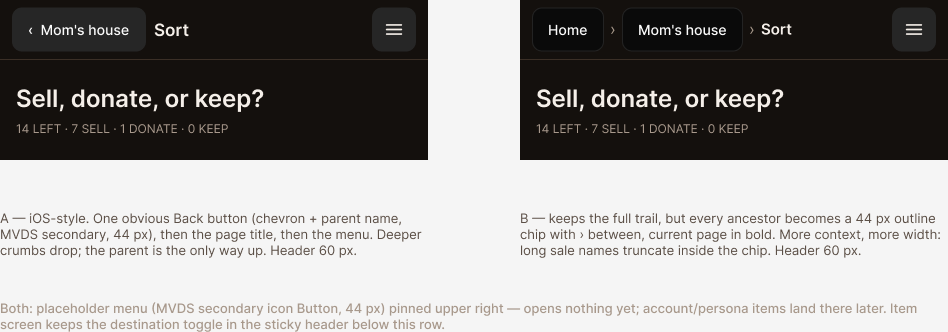

# Proposal: esp-header-affordance

> Follow-on to the Estate Sale Planner phone passes of 2026-10-28 (#564 ergonomics, #565 manifest,
> #566 durable sale and loading, #567 icon). Same app shell; this change is the sticky header only.

## Human anchor

> "I want to increase the affordance of the header/breadcrumb a bit, and also add in a placeholder
> hamburger in the upper right for when I have account/persona style activities"
>
> — Katy, 2026-10-28, after phone-testing the home-screen app

## Outcomes

- **Who:** Katy, phone-testing from the home-screen app (no browser back button in standalone);
  then the adult child clearing a parent's house.
- **Job:** Get back up a level without hunting for it, and know where account and persona things
  will live once they exist.
- **Done when:**
  - On a phone, the way back to the parent screen is unmistakably a button: a visible container
    and a back cue, at least 44 px, not muted text that happens to be a link.
  - The current page's name still shows in the header.
  - A menu button sits in the upper right of the header on every planner page, 44 px, labelled
    for screen readers. Tapping it opens a placeholder that says account and profile options are
    coming, and nothing else.
  - The item screen's destination toggle still rides in the sticky header under this row.
- **Not doing:**
  - Accounts, sign-in, personas or any real menu items. The menu is a placeholder only.
  - Changing the tab bar, routes, or which pages get the header.
  - A desktop-specific header. Desktop gets the same row, wider.

## Why

The breadcrumb went in as a stopgap (founder, 2026-10-27: "just do a simple breadcrumb style
header and let that function as the back button too"). On a phone it doesn't read as a control:
the parent crumb is 14 px muted text, the same weight as the slashes, with no container and no
back cue. Since #565 the planner opens standalone from the home screen, where there is no browser
back button, so the header is now the only way up a level. And account and persona work is coming,
and needs a home that doesn't move every screen when it arrives.

## What changes

- The `TopBar` row becomes a real navigation control on a phone, using MVDS `Button`, and the row
  grows to fit 44 px targets (about 60 px tall). Two treatments are drawn in round 02, and **one
  gets picked** before specs:
  - **A, back button:** one secondary button with a chevron and the parent's name, then the page
    title, then the menu. Deeper ancestors drop off. This is the familiar phone pattern, and the
    recommended one.
  - **B, breadcrumb chips:** the full trail stays, and every ancestor becomes a 44 px outline chip
    with › between, with the current page in bold. More context, but more width; long sale names
    truncate inside the chip.
- A placeholder menu button (MVDS secondary icon `Button`, menu glyph) is pinned to the upper right
  on every planner page, and opens a "coming soon" sheet.
- The header's height token (`--chrome-top-height`) follows, including the item screen's taller
  variant.

## Capabilities

### New Capabilities

- `esp-app-header`: the planner's sticky header: the way back up, the current page's name, and
  the placeholder menu slot.

### Modified Capabilities

None. The header was built under `estate-sale-planner-sold-comps` design D11 and never had a spec
of its own.

## Impact

- `app/estate-sale-planner/TopBar.tsx`: the row's layout, its back control, and the menu slot.
- `lib/estate-sale-planner/routes.ts`: `chromeFor` may need to hand the header the parent crumb
  directly (option A).
- A new placeholder menu component (a sheet or popover on MVDS tokens).
- `tests/estate-sale-planner/`: a header test (back target, title, menu button and its label).
- **Design:** Figma `esp-header-affordance`, pages `01 Current state` and `02 Proposed`.
- **No data, API or storage changes.**

## Open question for Katy

- **A or B?** A is the recommendation: it's the pattern a phone user already knows, and it leaves
  room for the menu without truncating. B keeps the whole trail visible.

## Optional links

- Figma: <https://www.figma.com/design/TsnWXZIK9TgMlxX7kPy9BQ>
  - `01 Current state`: page `0:1`, frame `2:2` (`Current · Mobile 428`)
  - `02 Proposed`: page `3:2`, frames `3:170` (`Proposed A · back button · Mobile 428`) and
    `3:183` (`Proposed B · breadcrumb chips · Mobile 428`)
- Prior header design: `openspec/changes/estate-sale-planner-sold-comps/design.md` (D11, D21)
- Experiment directory: `experiments/estate-sale-planner/`
