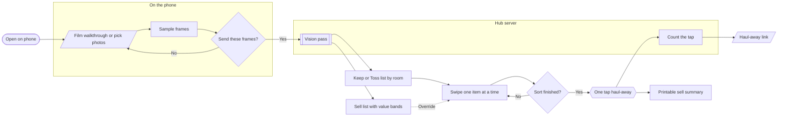

# Design: estate-sale-planner-build

## Context

New in-hub route, mobile-first: the phone is the camera. The product is a linear funnel
with one loop (swipe) and one exit (haul-away tap), on MVDS. Nearest hub precedent is
`etsy-listing-kit` (one input → one transformation → one exit); the copy and layout rules
promoted from ELK in `rules/design-guidelines.mdc` apply here unchanged.

## Goals / Non-Goals

**Goals:**

- One primary action per screen; a grieving user never faces a form.
- The vision pass is visibly a *guess with a confidence*, never an appraisal.
- Swipe works one-handed at 480 px; lists and summary read well at 1024 px.
- The exit CTA is a single centered button on its own line (founder rule).

**Non-Goals:**

- No accounts, sharing, or multi-user surfaces.
- No marketplace or listing screens (Build Unit 2).
- No bespoke chrome — MVDS components only, hub `.mvds-theme` wrapper (plain MVDS, not
  the hub's green skin), light mode is unreachable in the hub so the dark `.dark` tokens
  apply as they do for `/svg-to-stitch`.

## User flow / IA

Six screens, one route:

```
/estate-sale-planner
  1. Capture       film / pick video or photos            ← one button
  2. Frames        sampled grid + count + Send            ← confirm before anything leaves the phone
  3. Lists         Sell cards · Still to sort · Keep · Donate, toggle on every item ← tap = item
  3a. Item         full-screen: toggle, rename, room, band, note, detail shots, re-read, remove
  4. Sort          undecided pile one at a time: ← donate · keep → · Sell tap · Undo · Details
  5. Finish        donation-pickup CTA (own line, centered) ← counted row, then deep link / tel:
                   + print / Sell Sheet (secondary) + "haul the rest" link
  Tab bar          Lists · Sort · Finish, fixed to the bottom once a walkthrough exists
  History          earlier walkthroughs on this device, listed on the capture screen
  Second use       "Film another room" (Lists, Finish) → capture in add-room mode → items APPEND
                   "Start a new walkthrough" (capture, Finish) → clean start, old one stays in history
                   optional name ("Mom's house") on capture, Rename on Lists, shown in history + summary
  6. Summary       printable Sell list, "not an appraisal" first · Sell Sheet CTA ($5)
  7. Sell sheet    /sheet/[id] — the paid page: photos, bands, print, copy link
Recovery: no key → demo on the fixture set, says so · nothing flagged → honest empty Sell
          no Stripe → summary says payments aren't configured, print still works
          success URL before webhook → "settling" note, no items until Stripe confirms
```

The proposal-round flow as generated (the board's Mermaid source, kept here because the
thumbnail host is not reachable from the build environment):



## Visual design / Figma

Two files, both titled with the change ID per `rules/figma.mdc`. Round numbering runs
continuously across them: the proposal round is **02** on the board; the surface pair
continues as **02** on the design file (as-is is `01`).

| Item | Board (proposal round) | Design file (surface pair) |
| --- | --- | --- |
| Primary file URL | <https://www.figma.com/board/uafykXQHdW2h3YpBAy3Hfv> (`uafykXQHdW2h3YpBAy3Hfv`) | <https://www.figma.com/design/p75qmqHxUBh0TDLAUUXUmn> (`p75qmqHxUBh0TDLAUUXUmn`) |
| As-is frame(s) | Page `01 Current state` (node `1:2`), section `Current state` — net-new note | Page `01 Current state` (node `1:2`), frame `Current state · net-new` (node `1:4`) — documents the net-new surface, elk precedent |
| Proposed frame(s) | Page `02 Proposed — flow` (node `0:1`), anchor section `On the phone` (node `2:12`); generated via `generate_diagram`, 14 nodes | Page `02 Proposed` (node `1:3`): `Proposed · 01 Capture · Mobile 480` (`12:218`), `Proposed · 03 Lists · Mobile 480` (`13:33`), `Proposed · 03 Lists · Desktop 1024` (`13:106`), `Proposed · 04 Swipe · Mobile 480` (`12:229`), `Proposed · 05 Exit · Mobile 480` (`12:251`). Frames 02 (frame grid) and 06 (summary) are the built surface only — a thumbnail grid and a print table add no composition question the other five don't answer |
| Libraries / version | FigJam page-per-iteration conventions per `rules/figma.mdc` | `MVDS Core` (`C20nU0mROzk3Zr0I9BELJF`, subscribed 2026-10-13, `source: team`) — instances of `Button`, `Badge`, `Card`, `Callout`; fills bound to the `Tokens` collection (`Color/background`, `foreground`, `muted-foreground`, `border`) with the collection pinned to **Dark** on every frame, matching the hub. Code: `@beckharrisdesign/mvds@0.5.0`. **Two mirror deviations, both recorded:** `Dropzone` and `Input` are not in the published library yet (import by key fails; the 0.5.0 changelog notes they reached Figma after the last publish), so the capture zone is a dashed stand-in frame named `Dropzone (stand-in: not yet published in MVDS Core)`; and Figma forbids inserting children into an instance, so the band/confidence `Badge` row sits beneath each `Card` rather than inline with the title as in code |
| Code Connect | N/A — no code surface | Not set up (no published hub component library to map against — elk precedent); implementation maps to MVDS components in code |
| Breakpoints | N/A — FigJam canvas, not a responsive screen | S · 480 px mobile (primary) / L · 1024 px desktop (review layout) — `rules/design-guidelines.mdc` |
| Status | **Round 02 drawn** 2026-10-13 (rough — shape and sequence, as the proposal round should be) | **Round 02 drawn** 2026-10-13 on MVDS Core, dark, five frames; composition screenshot taken in-session, every text node in Inter (the product font: MVDS sets `--font-heading: var(--font-sans)`). **Round 02.1 drawn** 2026-10-13 after founder feedback; **Round 02.3 drawn** 2026-10-13 (sell sheet; page `32:73`, frames `32:74` / `32:109`); **Round 03 drawn** 2026-10-13 (keep / sell / donate, item screen, sort; page `36:73`, frames `36:74` / `36:119` / `36:109`); **Round 04 drawn** 2026-10-13 (add rooms, naming; page `41:113`, frames `42:81` / `41:114`) — see below. Implementation captures at `assets/built-*.png` (round 02 → `built-0N-*`, round 02.1 → `built-02.1-*`) |

**Library:** MVDS Core was toggled on by the founder 2026-10-13 (`get_libraries` →
`source: "team"`) before any proposed frame was built.

### Round 02.1 — type ramp, card contrast, item images (2026-10-13)

Founder feedback on round 02, verbatim: *"the typography is clunky and the card for each
found item needs to have more contrast and an image of what it thinks it found."* Three
changes, each applied in code and mirrored on the design file's page
`02.1 Proposed — type ramp, card contrast, item images` (node `21:2`), frames
`Proposed 02.1 · 03 Lists · Mobile 480` (`21:225`) and
`Proposed 02.1 · 04 Swipe · Mobile 480` (`21:315`):

| Feedback | Round 02 | Round 02.1 |
| --- | --- | --- |
| Typography | Hand-picked Tailwind sizes (`text-2xl`, `text-sm`, `font-semibold`) per screen | Every text node on the **MVDS type ramp**: `text-h1`/`text-display` for the capture headline, `text-h2` for list headings, `text-h3` for the swipe card title, `text-body-lg` intro, `text-body` reasons, `text-small` meta, `text-caption uppercase tracking-wider` eyebrows (room / section labels). In Figma the same ramp is bound through the `Typography/*` size variables |
| Card contrast | `Card` default (`bg-card` + 10 % ring, no elevation) on the `background` surface | `Card` with `shadow-lg` (MVDS `--elevation-lg`) and `ring-foreground/15`; eyebrow → title → badges → reason stack inside `CardHeader`; actions in `CardContent`. Desktop Sell list is a two-column `Grid` so cards keep a card's proportions instead of stretching to 1024 px |
| Image of what it found | None — text only | **Image-first card**: the vision pass now returns, per item, the `frame` index it is clearest in and a nullable normalized `box` (`x y w h` ∈ 0–1); the phone crops a square thumbnail from the frame the user already confirmed (`lib/estate-sale-planner/thumbs.ts`, 320 px JPEG, box padded 15 %, floored at 28 % of the frame, whole frame when `null`). No second model call, nothing new leaves the device. The Sell card leads with a 4:3 image, the swipe card with a square one, Keep / Toss rows and the summary table carry a small thumb |

**Figma deviation, recorded:** MVDS `Card` instances cannot take children, so the 02.1
frames use a local component **`Item card`** (`21:208`: image slot, eyebrow, title, inline
badge row, reason, action row) built from MVDS tokens and `Badge`/`Button` instances. This
supersedes the round-02 "badges beneath the card" workaround and is the shape of the MVDS
hand-off: a `Card` variant with an image slot and a badge row (review queue #28).

**Component mapping (MVDS → screens):**

| Need | MVDS | Product-local? |
| --- | --- | --- |
| Capture / Send / Keep / Toss / haul-away CTA | `Button` (default, `outline`, `destructive` for Toss) | No |
| Frame grid, list rows, swipe card | `Card` (image as first child → `has-[>img:first-child]:pt-0`) + `CardHeader`/`CardTitle`/`CardDescription`/`CardContent` on `Grid` / `Stack`; `shadow-lg` + `ring-foreground/15` for the found-item cards | No (Figma mirror uses a local `Item card` until MVDS Core ships a Card image slot) |
| Value band + confidence | `Badge` (`muted` for low confidence) | No |
| "Not an appraisal" / "closing the tab loses this" | `Callout` | No |
| Photo fallback picker | `Dropzone` (code) — stand-in frame in Figma until the library publishes it | No |
| Page scaffolding | `Section`, `Container`, `Stack`, `Inline` | No |
| Swipe gesture handling | — | Yes: small pointer-event hook; visual is still a `Card` |
| Per-item destination toggle | `Button` ×3 (`default` active, `outline` inactive) in an `Inline` | Yes, as composition (MVDS has no segmented control — hand-off) |
| Item screen fields | `Field` + `Input` / `Textarea` / `Select` | No |
| Bottom tab bar | `Layer level="float"` + `Button` (`default` / `ghost`) | Yes, as composition (no MVDS tab bar — hand-off) |

### Round 02.3 — shared rails and the paid moment (2026-10-13)

Founder review of the experiment's design, verbatim: *"why are we planning on a key I
don't have when I do have chatgpt and other openai keys? what about stripe or supabase?"*
and *"we need some sort of payment in the model."* Three changes, all on infrastructure
the hub already runs:

| Concern | Round 02.1 | Round 02.3 |
| --- | --- | --- |
| Vision provider | Anthropic SDK on a key the hub does not hold | **OpenAI first** (`OPENAI_API_KEY`, the hub's synced model key) via plain fetch and a strict JSON schema; Anthropic kept as the alternate — the ELK composer's order |
| Counting | Exit taps as a log line in Vercel function logs, which expire before the 14-day window | **`esp_events` rows** (migration 016); log line kept as the no-database fallback |
| Payment | None on the family's side; revenue waited on an affiliate deal | **Sell Sheet, $5 one-time**: the summary's free print stays, and beside it a `Card` sells the same list with photos at a shareable link (`/sheet/[id]`). Stripe Checkout on the hub's shared key; this route's own webhook endpoint; `esp_sheets` row; buyer email → `experiment_submissions` |

Figma: page **`02.3 Proposed — sell sheet`** (node `32:73`), frames `Proposed 02.3 · 06 Summary · Mobile 480` (`32:74`) and `Proposed 02.3 · 07 Sell sheet · Mobile 480` (`32:109`), both cloned from the 02.1 Lists frame so the `Item card` instances and token bindings carry over; composition screenshot taken in-session, clean on the first pass, every text node in Inter. The founder's own page `02.2 Proposed — Manual design edits` (`22:152`) is hers and untouched. One mirror deviation: the Figma summary shows the Sell items as cards (the 02.1 `Item card`) where the built summary is a print table — the table adds no composition question the cards don't answer, and the paid card beneath is the thing this round draws.

Surfaces: the summary gains one `Card` (eyebrow *Keep this list* → `CardTitle` → `CardDescription` with the price → one centered `Button`; the free print demotes to `outline` when the paid CTA is present). The sheet page reuses the 02.1 image-first `Item card` in a two-column `Grid`, with print and copy-link beneath. Figma page **`02.3 Proposed — sell sheet`** carries both frames (see the Visual design table). Captures: `assets/built-02.3-summary-mobile-480.png` (CTA) and `assets/built-02.3-summary-unconfigured-mobile-480.png` (no Stripe).

### Round 03 — keep / sell / donate, the item screen, detail shots (2026-10-13)

Founder direction, verbatim: *"no we won't call it tossing -- keep, sell, donate are the
options, and we should be able to toggle between then per item. but there are moments where
a user needs to take additional details like a seam or a stamp on the bottom."* and
*"consider mobile navigation paradigms - editing a profile, finding history, crud operations
on each elements, correcting an object recognition decision that isn't right."*

| Concern | Round 02.3 | Round 03 |
| --- | --- | --- |
| Destinations | Sell / Keep / Toss, a one-way funnel (Sell → Keep/Toss, swipe decides, undo last only) | **Keep / Sell / Donate** on every item, toggled from any list any time; per-change undo. Model-flagged items start at Sell. No Toss |
| Navigation | Linear steps | **Bottom tab bar** once a walkthrough exists (Lists · Sort · Finish, MVDS `Layer` float) and the **list → item push**: tap any card or row to open the item full-screen with a Back button |
| CRUD | None | **Edit** name, room, band (`Select` over the bands), what the family knows (`Textarea`), saved as you type; **Remove** with one confirmation, for reflections, duplicates and wrong calls; **Add** something the model missed from the lists, starting with an honest low-confidence read |
| Correcting a wrong recognition | Only "keep instead" | A rename plus a band on the item screen, or a detail shot that re-reads it; the destination is never a side effect |
| Detail shots | None | Up to three close-ups per item (1024 px JPEG, `DETAIL_SHOT`), each posted to `api/refine` with the note; the item comes back with a better name / band / reason / confidence and **what the mark says**. Fixture mode keeps the photo and says nothing was re-read |
| History | Closing the tab loses it | The last six walkthroughs saved on the device (`localStorage`, images dropped on quota) and listed on the capture screen with Open / Delete; the active one still resumes from `sessionStorage` |
| Exit | Junk haul for the toss list | **Donation pickup** for the donate list (Pickup Please; Salvation Army fallback), the sell list's own exit as the secondary button, junk haul demoted to a "haul the rest" link |
| Sort gestures | ← toss · keep → | **← donate · keep →**, Sell a deliberate tap (the two a thumb reaches for on a phone; three-way swipe was rejected as unlearnable) |

Captures: `assets/built-03-{lists,detail,sort,exit,capture-history}-mobile-480.png`. Figma: page **`03 Proposed — keep / sell / donate, item screen, detail shots`** (node `36:73`), frames `Proposed 03 · 03 Lists · Mobile 480` (`36:74`: toggle + Details beneath each card, toggles on every still-to-sort row, add-item button, tab bar), `Proposed 03 · 03a Item · Mobile 480` (`36:119`: Back, the card, destination toggle, closer-look actions, four field stand-ins, remove), `Proposed 03 · 04 Sort · Mobile 480` (`36:109`: Donate / Keep / Sell, Details · Undo, tab bar). Composition screenshot taken in-session, clean on the first pass, every text node in Inter. Two recorded mirror deviations: toggles sit beneath the `Item card` instances (instances cannot take children, as in 02.1) and the item screen's fields are dashed stand-ins because `Input` / `Select` / `Textarea` are not in the published MVDS Core library (#24). The tab bar is drawn as the frame's last child, labelled as fixed in code.

### Round 04 — the second use (2026-10-13)

Founder question, verbatim: *"so what does the second use of the product do - keep adding
to the same list? start over?"* The honest answer was "starts over, and there was no way
back to the capture screen while a walkthrough was active." Approved: *"sure approved - I
want to try this out!"*

| Concern | Round 03 | Round 04 |
| --- | --- | --- |
| Second room | Close the tab, film again → a separate session | **Film another room** on Lists and Finish → capture in add-room mode → the new items **append** to the same walkthrough (`appendItems`, ids carry the pass number); the lists say how many were added |
| Re-walking a room | Duplicates | The flag request carries `known` (every listed name + room); the prompt says not to return them unless clearly a different object |
| Starting over | Only by closing the tab | **Start a new walkthrough** on the capture screen (add-room mode) and on Finish; the active one stays in history |
| Naming | A date | Optional name on the capture screen, **Rename** on Lists; shown in history, the lists header and the summary |
| Demo mode | The whole sample house at once | Grows **room by room** from the known list — first pass three rooms, each later pass the next room, then "nothing new" — so the append is felt without a key |

Captures: `assets/r04-{capture-append,lists-named,capture-history}.png` (short names: the round-02 captures already use `built-04-` for the swipe screen, and the PR body tool escapes image URLs longer than about 155 characters). Figma: page **`04 Proposed — add rooms, naming`** (node `41:113`), frames `Proposed 04 · 01 Capture (add a room) · Mobile 480` (`42:81`, cloned from the round-02 capture: Back, Add-a-room eyebrow, "Film another room", the dropzone stand-in, the "different house" line) and `Proposed 04 · 03 Lists (named, add a room) · Mobile 480` (`41:114`, cloned from round 03 with the walkthrough header `43:86`: name + Rename, pass count, Film another room). Composition screenshot clean on the first pass, all text in Inter.

### Round 05 — proposed, not built (2026-10-15)

First real use on Katy's phone produced five signals, verbatim in
[`docs/intent.md`](../../../experiments/estate-sale-planner/docs/intent.md): photos instead
of video, recropping the originals, outlines later, a nav you can see, and a persistent
record of sales with estimated vs sold. The triage and proposal live in
[`docs/round-05-proposal.md`](../../../experiments/estate-sale-planner/docs/round-05-proposal.md)
(review queue #46–#50, all `PROPOSED`). The fifth item re-defines the product as a system
of record — accounts, a schema, a lifecycle — which the parent `propose.md` excluded; the
proposal recommends dogfooding one real sale, then re-proposing the parent. Sequence
offered: 05a photos + shell → 05b accounts + record → 05c recrop + actuals. No design or
code changes until she answers the eight decisions at the end of that document.

## Decisions

1. **Board for the proposal round, design file for the pair.** The proposal's question is
   a sequence (capture → flag → swipe → exit), so the first round is a board; the surfaces
   are a design-file question and get the as-is + proposed pair there.
2. **Mobile is primary.** 480 px frames are the ones that matter; 1024 px is a review
   layout for the lists and summary, not a different product.
3. **Sell flags are visibly guesses.** Every band carries a confidence `Badge` and the
   summary leads with the "not an appraisal" line — the product's honesty is a design
   property, not a footnote.
4. **Toss is `destructive`, Keep is default.** The irreversible-feeling action gets the
   stronger colour; Undo is always visible beneath the card.
5. **Screenshots in the PR are of the built surface, not the Figma frames.** The Figma
   thumbnail host (`s3-alpha.figma.com`) is denied by the build environment's egress
   policy; the committed `assets/built-*.png` are Playwright captures of the running route
   at 480/1024 px, and the Figma frames were verified by inline screenshot in-session.
6. **Type comes from the ramp, never from a per-screen size.** Round 02.1 removed every
   ad-hoc `text-*`/`font-*` size; hierarchy is eyebrow (caption, uppercase) → heading
   (h1–h3) → body → small. If the ramp lacks a step, that is an MVDS change, not a local
   override.
7. **Found-item cards earn their contrast with an image, elevation, and a stronger ring,
   not with a new colour.** `shadow-lg` + `ring-foreground/15` on the `card` surface is the
   whole recipe; the thumbnail does most of the work.
8. **The thumbnail is cropped on the phone from a frame the user already approved.** The
   model only says *where* (frame index + normalized box). That keeps the image honest
   (it is literally what the model looked at), costs no extra tokens, and sends nothing
   new off the device.
9. **Shared rails before new credentials.** The provider, the database, and the payment
   rail are whichever the hub already keys and syncs; a design that needs a new secret
   has to argue for it in the review queue first (round 02.3 reversed round 01 on this).
10. **The webhook unlocks the sheet, never the success URL.** ELK's rule, reused with its
    decision logic. The sheet page shows a "settling" note until Stripe confirms.
11. **The link is the credential.** A sheet is a UUID path with no account and `noindex`;
    anyone with the link can open it, which is the point of a sheet you send to siblings.
    Said on the page in one line.
12. **Destination is a field, not a funnel.** Keep / Sell / Donate live on the item and
    the toggle is on every surface; the swipe is a fast path over the undecided pile, not
    the only way to decide. There is no Toss (founder instruction).
13. **Mobile is list → item push plus a tab bar.** One route, client state: the item
    screen replaces the step while open and Back returns to it; the bar is fixed to the
    bottom on the float layer and the page pads for it. No modals.
14. **A re-read never moves an item.** The model may change what it thinks a thing is and
    what it is worth; where it is headed is the family's call, every time.
15. **History is on the device, nothing more.** Six walkthroughs in `localStorage` is
    "finding history" without accounts; the paid Sell Sheet remains the only copy that
    leaves the phone.
16. **A walkthrough is a house, not a video.** Rooms append over days; the model is told
    what is listed; starting over is a named choice, never a side effect of coming back.

## Risks / Trade-offs

- **Two library gaps in the mirror** (`Dropzone`/`Input` unpublished; no children inside
  instances). Both are recorded above and in the review queue; the first is an MVDS
  hand-off (publish the library), the second is a Figma constraint, not a design choice.
- **Frame sampling on low-end phones** may be slow for a 10-minute video. Mitigation: the
  sampler runs incrementally with a progress bar and the budget cap is low by default.
- **Dark-only hub** means the product cannot be previewed in MVDS light mode inside the
  hub; the Figma pair should be drawn in dark to match what ships.
